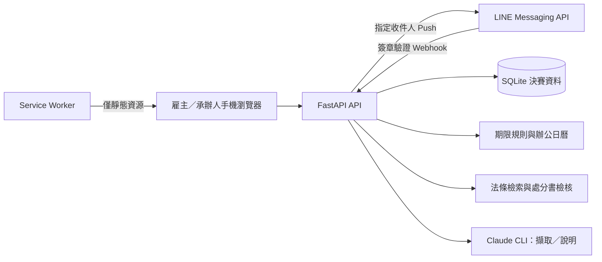

# 竹聘安｜決賽系統開發工作包

版本：2026-11-14　｜　開發額度：**130 人時**　｜　程式碼基線：[ai.zhupinan](https://github.com/Johnnnny0823/ai.zhupinan)

## 1. 交付目標

11 月 20 日晚間交付一套可在手機與電腦操作的決賽系統。現場必須完成以下五段流程：

1. 雇主選擇一份**合成公文**，確認讀取結果，產生有期限、起算依據、辦理窗口與官方入口的待辦。
2. 雇主查看一項待辦的來源、計算過程、辦理狀態與證明；上傳證明後由雇主確認完成。
3. 綁定一個指定 LINE 帳號，發出**該雇主案件**的提醒，手機收到去識別化訊息。
4. 雇主進入「聯絡不上移工」流程，依實際應工作日與聯繫狀況取得下一步；不自動宣告移工行蹤不明。
5. 市府端貼上**合成裁處書草稿**，檢查七項要件；法規問答可依已確認的個案資料回答並列出條文。

**交付性質：決賽示範系統。** 所有公開展示、訪談操作測試與截圖使用合成資料。正式接收真實公文、真實移工資料或供市府實際辦案，另需法規與資安審查、資料處理文件和部署規劃；不得在決賽簡報中宣稱已可正式試辦。

### 必須保留的技術原則

- 模型只讀取文件欄位、協助白話解釋；法定日期一律由 `validation/scripts/rules.py` 的確定性規則計算。
- 擷取欄位未經使用者確認，不能寫入案件或產生待辦。
- 每項日期顯示：**事件／起算日／計算規則／原到期日／假日順延／最後期限／條文版本**。規則無法判斷時顯示「需人工確認」，不能猜日期。
- 處分書檢核只指出可能缺漏與理由；處分、裁量和送出由承辦人決定。
- 所有決賽資料一鍵重置；網路或模型故障時仍能以明確標示的合成範例走完展示。

## 2. 現況與本次改動邊界

現有後端為 Python／FastAPI，前端為原生 HTML、CSS、JavaScript；已有擷取、規則、BM25 條文檢索、處分書檢核和 LINE 手動推播。驗證資料和展示程式共用 `validation/scripts/`。維持這個技術棧，不在決賽前搬到 React 或重寫規則引擎。

現況須修正的行為：`state.json` 共用一份資料、讀取待辦 API 未設權限、上傳原件落磁碟、清空待辦未刪上傳檔、所有 LINE 好友可能收到同一批待辦、推播須人工按鈕觸發、沒有 Manifest／Service Worker。這些分別列入 S01、S02、S05、S09。

**不納入 130 人時**：跨縣市部署、市府正式介接、真實移工資料匯入、仲介免登入分享連結、Web Push、完整移工端、多語內容正式發布、仲介評分、失聯預測、正式採購系統。完成標準以本文件的驗收條件為準。

## 3. 系統結構與技術選型

| 層 | 決定 | 原因與限制 |
|---|---|---|
| 前端 | 保留原生 HTML／CSS／JavaScript；可拆成 ES Modules | 現有系統可直接改；不新增打包流程。手機寬度 320、390、768、桌面 1280 px 驗收。 |
| 後端 | FastAPI、Pydantic 2、Python 3.12 | 沿用目前入口 `demo/server/app.py`，逐步抽成 `db.py`、`auth.py`、`storage.py`、`notifications.py`。 |
| 儲存 | SQLite、`sqlite3`、參數化 SQL、外鍵、交易 | 決賽單機部署足夠；每次寫入在交易中完成。禁止直接拼接 SQL。 |
| 登入 | 預建示範帳號＋一次性登入碼；伺服器端 Session | 不開放註冊。Session cookie 設 `HttpOnly`、`SameSite=Lax`；公開 HTTPS 使用 `Secure`。變更資料的請求檢查 `Origin`。角色為 employer／officer。 |
| 文件 | 記憶體／暫存檔處理，完成後刪除 | 只支援 JPG、PNG、PDF、TXT；限制 15 MB、PDF 10 頁，檢查 MIME 與實際檔案格式。掃描圖只使用合成範例。 |
| LLM | 保留 `demo/server/llm.py` 的 Claude CLI 呼叫 | 模型失敗回傳可讀錯誤；演示範例可進入預存結果，不暗中把預存結果當即時辨識。 |
| 日期 | 現有 `rules.py`＋2026／2027 辦公日曆 | 保留現有測試；日曆範圍外顯示「需人工確認」，禁止默默只按週末順延。 |
| LINE | Messaging API Push／Reply＋Webhook | Webhook 先驗原始 body 的 `x-line-signature`，以配對碼綁定案件，推播須有冪等紀錄。 |
| PWA | Manifest＋Service Worker | 只快取 HTML／CSS／JS／圖示／公開說明；案件 API、圖片、證明、登入回應一律不快取。LINE 是通知主通道。 |

### 資料表最低要求

| 表 | 必要欄位 | 要求 |
|---|---|---|
| `accounts` | `id`, `role`, `display_name`, `created_at` | 示範帳號由 seed 建立；`role` 只接受 `employer`、`officer`。 |
| `sessions` | `id_hash`, `account_id`, `expires_at` | Cookie 只放隨機憑證；資料庫存雜湊，不存明文。 |
| `cases` | `id`, `owner_id`, `display_code`, `created_at`, `updated_at` | API 依 `owner_id` 限制存取；展示名稱用代號。 |
| `documents` | `id`, `case_id`, `kind`, `source_filename`, `confirmed_fields_json`, `confirmed_at`, `source_digest` | 不保存原件；`source_digest` 用 SHA-256 供比對，不當成個資匿名化證明。 |
| `tasks` | `id`, `case_id`, `document_id`, `rule_key`, `event_date`, `start_date`, `due_date`, `law_ref`, `law_version`, `calc_trace_json`, `status`, `office`, `official_url` | `status` 限定 `todo`、`delegated`、`proof_submitted`、`done`、`needs_review`；同一文件＋規則避免重複產生。 |
| `proofs` | `id`, `task_id`, `submitted_at`, `observed_date`, `verdict`, `confirmed_at` | 上傳只暫存供判讀；判讀結果與人工確認分開。AI 判為準時不得自動改 `done`。 |
| `line_bindings` | `account_id`, `line_user_id`, `bound_at`, `revoked_at` | 一筆有效綁定只屬於一個雇主帳號；可解除。 |
| `notification_log` | `account_id`, `task_id`, `notice_type`, `send_date`, `status`, `line_request_id` | 唯一鍵避免重複推播；記錄失敗原因，不記錄訊息全文或證件號。 |
| `audit_events` | `actor_id`, `case_id`, `entity_type`, `entity_id`, `action`, `created_at` | 只記動作與 ID，不記原始公文／完整個資；用於說明誰確認了日期與完成狀態。 |

`owner_id` 是資料隔離條件，不得只在前端過濾。資料庫與上傳暫存路徑須列入 `.gitignore`；重置時清除案件、文件、證明、LINE 綁定、通知紀錄與暫存檔，保留法規與合成種子。

### API 契約

| 端點 | 用途 | 權限與關鍵回應 |
|---|---|---|
| `POST /api/session`、`DELETE /api/session` | 登入／登出 | 示範帳號；錯誤碼 401、429；過期 Session 失效。 |
| `GET /api/cases`、`GET /api/cases/{id}` | 案件清單／詳情 | 雇主只讀自己的案件；無權限回 404，避免洩漏 ID 是否存在。 |
| `POST /api/documents/extract` | 暫時擷取欄位 | 回傳 `field`, `value`, `source_excerpt`, `warning`, `document_kind`；**不寫正式案件**。 |
| `POST /api/documents/confirm` | 確認欄位並產生待辦 | 必填 `case_id`、使用者確認的欄位、文件類型；回傳 `task_ids` 和警示。 |
| `GET /api/tasks/{id}`、`PATCH /api/tasks/{id}` | 詳情與狀態 | 伺服器端檢查 owner；只允許合法狀態轉移。 |
| `POST /api/tasks/{id}/proof`、`POST /api/tasks/{id}/confirm` | 證明判讀／人工完成 | 判讀、確認兩步分開；拒絕檔案格式錯誤。 |
| `POST /api/line/pair-code`、`DELETE /api/line/binding` | 配對／解除 | 配對碼一次性、10 分鐘失效；Webhook 收到後綁定對應帳號。 |
| `POST /api/line/preview`、`POST /api/line/send-demo` | 預覽／指定帳號測試 | 禁止向全部好友廣播；回傳實際收件人數及發送結果。 |
| `POST /line/webhook` | LINE 事件 | 先驗簽章，再解析 JSON；只處理配對、待辦查詢與取消綁定。 |
| `POST /api/missing/guide` | 失聯流程判斷 | 回傳狀態、缺少的事實、聯絡資訊與法源；不寫「已行蹤不明」結論。 |
| `POST /api/qa`、`POST /api/penalty/check` | 個案問答／處分書檢核 | 問答只取已確認的個案事實；承辦人功能只允許 officer。 |
| `POST /api/demo/reset` | 重置展示資料 | 僅示範管理帳號；重建固定合成案件。 |

現有 API 可保留作內部呼叫；前端以新契約使用。改動 API 時同步更新 `demo/API.md`，寫出請求／回應範例及錯誤碼。

## 4. 工作包與工時

工時為**人時**，含實作、基本測試與整合修正，不含簡報、訪談、法規專家核對。任一工作包完成時，提交程式、可重跑的驗收結果及一段螢幕錄影或截圖。不可只交靜態畫面。

| 編號 | 工作包 | 人時 | 前置 | 主責建議 |
|---|---|---:|---|---|
| S00 | 基線、分支與驗收環境 | 5 | 無 | 整合負責人 |
| S01 | 後端資料模型、登入與權限 | 22 | S00 | 後端 |
| S02 | 文件擷取與隱私處理 | 15 | S01 的模型契約 | 後端＋前端 |
| S03 | 規則結果、待辦與證明狀態 | 13 | S01 | 後端 |
| S04 | 雇主手機介面與互動 | 26 | S01 API 契約；可與 S02／S03 並行 | 前端／設計 |
| S05 | LINE 配對、提醒與排程 | 14 | S01、S03 | 後端 |
| S06 | 聯絡不上移工流程 | 8 | S03 | 前後端 |
| S07 | 個案上下文問答 | 8 | S01、S03 | 檢索／後端 |
| S08 | 承辦人端整理 | 6 | S01 | 前後端 |
| S09 | PWA 安裝與離線頁 | 7 | S04 主介面 | 前端 |
| S10 | 種子資料、故障備援、端到端驗收 | 6 | S02–S09 | 整合／測試 |
|  | **合計** | **130** |  |  |

### S00｜基線、分支與驗收環境｜5 人時

**交付**：鎖定一個可運行 commit、建立 `release/hackathon-2026` 分支、`demo/DEVELOPMENT.md`（啟動、環境變數、測試、資料重置）、`demo/API.md` 初版。記錄 Python 版本、依賴套件版本與啟動命令。`line.env`、資料庫、上傳目錄不進版控。建立合成資料的唯一標記 `DEMO_DATA=true`。

**驗收**：全新 Windows 電腦依文件可在 20 分鐘內啟動；`/api/health` 回傳服務、規則庫版本、日曆涵蓋年份及示範模式，不回傳金鑰。保留現有 `validation/` 基準分數，重跑指令記錄在文件。

### S01｜後端資料模型、登入與權限｜22 人時

**交付**：`schema.sql`、`db.py`、`auth.py`；從 `state.json` 改為 SQLite；用 `sqlite3.Row` 或 Pydantic 型別化回應。每個案件、待辦、證明查詢都套 `owner_id`；承辦人端獨立角色。示範登入碼在環境變數設定，伺服器端驗證、限制連續錯誤嘗試，Session 過期與登出可用。重置交易一次刪完資料、失敗則回滾。保留資料遷移腳本供既有合成資料轉入，正式執行前備份。

**驗收情境**：A 雇主不能讀、改、刪 B 雇主案件；承辦人只看合成裁處書示範，不讀雇主案件；匿名呼叫待辦、證明、LINE 發送 API 得 401；雇主呼叫承辦人 API 得 403；不符來源的跨站變更請求被拒絕；登出後 Cookie 失效；重置後資料庫無案件與綁定。至少以兩個示範帳號測一次越權。

### S02｜文件擷取與隱私處理｜15 人時

**交付**：上傳先檢查大小、類型、頁數；不信任副檔名。原始 bytes 放記憶體或專用暫存檔，`try/finally` 刪除；例外時也清理。純文字進 LLM 前先執行現有 `privacy.mask`，記錄**送出內容的遮蔽預覽**。圖片／掃描 PDF 只開放合成範例；真實圖片模式顯示停止與說明，不能偷偷直送外部模型。結果每個關鍵日期列出文件片段；民國年、國字日期、掃描件標「需核對」，不以未校準的 confidence 數值分級。使用者可逐欄修改再確認。確認後只保存必要欄位與摘要，不保存公文原件；刪除功能覆蓋資料庫紀錄、暫存、預覽與快取。

**驗收情境**：錯副檔名、超過 15 MB、壞 PDF 均有可理解錯誤且無殘檔；關閉或錯誤後無原件滯留；未確認日期不能產生待辦；修改日期後期限按新日期重算；掃描合成範例可展示，真實圖片不出站。以現有 266 筆合成個資測試確認文字遮蔽沒有退步，測試紀錄明示「不含掃描圖」。

### S03｜規則結果、待辦與證明狀態｜13 人時

**交付**：保留 `rules.compute`，新增 API 映射與 `calc_trace`；展示日期計算中每一步及法規／日曆版本。待辦狀態機：`todo → delegated → proof_submitted → done`，也允許 `todo → proof_submitted`；證明判讀僅填 `verdict`，不自動完成。逾期是由 `due_date` 與現在日期推導的標籤，並非狀態。提供官方辦理窗口及直接連結；連結只用明確白名單。文件重複匯入不能產生重複待辦。規則所需日曆超過 2027 年時回 `needs_review`。

**驗收情境**：同一公文重傳不重複；春節／補假案例期限與既有 33 筆測試一致；證明顯示「準時」後仍等雇主確認才 `done`；逾期後補辦仍可留存逾期事實；個案詳情看得到起算日、順延原因、條號、辦理窗口及官方入口。

### S04｜雇主手機介面與互動｜26 人時

**交付畫面**：① 今日待辦 ② 文件確認 ③ 待辦詳情 ④ 聯絡不上移工入口 ⑤ LINE 配對／提醒預覽。視覺以「案件手帖」的日期索引、文件邊註、分隔線列表與單一重點色為方向；實作時以 `D:\竹聘安\concept\index.html` 作畫面草稿，接上真實 API。介面文字使用「要辦什麼、何時前、去哪裡辦、我已辦好」等動詞，避免工程詞或 AI 自評。待辦清單先按緊急度排序，可切換全部／本週／已完成；每列至少有事項、日期、狀態、案件代號。詳情用折疊區顯示法源與計算，主動作連到官方辦理入口。確認頁標示擷取來源與修改欄位，按確認前顯示將新增的待辦數。

**互動規格**：手機 320 px 不橫向溢出；文字不小於 16 px；點擊區至少 44×44 px；所有表單有標籤、錯誤文字與鍵盤焦點；不得只靠顏色表達狀態。載入／空資料／逾期／API 失敗／離線都有明確畫面。大欄位採一頁一個主要決定，避免把文件原圖和十多個輸入欄硬擠在手機同一列。桌面承辦人畫面獨立排版。保留 `prefers-reduced-motion` 支援。無卡片海、漸層儀表板或無功能按鈕。

**驗收情境**：用 320×700、390×844、768×1024、1280×800 截圖；雇主不用口頭提示可從合成公文完成確認、開啟官方入口、回來確認已辦；鍵盤可走完整個主要流程；錯誤狀態不顯示空白頁。

### S05｜LINE 配對、提醒與排程｜14 人時

**交付**：雇主網頁產生 6 位一次性配對碼，有效 10 分鐘；在 LINE 對話輸入配對碼才建立 `line_bindings`。Webhook 用原始 request body 驗 HMAC-SHA256，驗完才解析。LINE「待辦」只查該 `line_user_id` 綁定帳號的近期事項；未綁定時只回配對教學。訊息文字包含事項、日期、案件代號與網頁入口，不含移工全名、護照號、地址、病況或處分內容。排程在展示機以 Windows Task Scheduler 每日執行一次命令列通知程序；通知條件為到期前 7、3、1 日及當日，每個任務／類型／日期只發一次。保留受權人可按的「發送測試訊息」，只發該帳號。LINE API 失敗寫 `notification_log` 並可重試；解除綁定後不可再接收。

**驗收情境**：兩個手機帳號各綁一個雇主，互傳「待辦」看不到對方資料；向另一帳號發送測試不會誤投；重跑排程不重複發；無效簽章拒絕；解除綁定、過期配對碼均失效。決賽日前以真實手機測至少一次 Push 和一次 Reply，錄下結果與當時網路環境。

### S06｜聯絡不上移工流程｜8 人時

**交付**：先問「今天是否原本應工作」「最後實際出勤日」「之後各日是否應工作」「聯絡嘗試與結果」「是否已掌握可核實的住宿地點／期間／聯絡方式」。畫面區分「先聯繫及確認」「可能符合要件，請核對」「需盡速向主管機關確認」三種狀態；不使用「系統判定失聯」字樣。提醒不得扣留證件，提供 1955、主管機關與官方通報資訊。週末若是應工作日則納入，若是休息日則不納入；不得只用日曆天或最後聯絡日推算。對 1955 求助的情況提示仍需依可核實事實判斷，不能自動認定不屬失聯。

**驗收情境**：至少 6 例：連續 3 個應工作日、跨週末但週末休息、週末值班、聯絡恢復、已向 1955 求助但資料不足、可核實安置資訊。每例列輸入與預期提示；文案經組內法規負責人對照 [認定基準](https://fw.wda.gov.tw/wda-employer/home/download-file/2c95efb3882b4eb201882d403147023b.pdf) 後簽名確認。這項組內檢查屬開發驗收；外部專家審查另計。

### S07｜個案上下文問答｜8 人時

**交付**：問答組裝 `CaseContext`，只帶已確認的 `case_id`、文件日期、待辦日期、規則計算摘要；以案件權限查詢後，與現有 BM25／同義詞檢索結果一起送模型。模型不得自行重算期限或補出資料庫沒有的事件。回答分「這個案件目前已知」「相關規定」「下一步」「尚需確認」四段，每個法定天數附條號；沒有足夠依據就顯示轉介資訊。提示中把公文內容視為資料，不能把其文字當系統指令。記錄使用的條文 ID、資料版本與回覆時間，不記錄全文敏感輸入。

**驗收情境**：原有 10 題保留題不得退步；新增 5 題個案問題，答案中的日期與已存 Task 一致；問不存在的日期時回「尚未確認」；用文件內惡意指令測試，回答不得洩露其他案件或改變規則。

### S08｜承辦人端整理｜6 人時

**交付**：保留七項檢核，改成每一項顯示「已找到／可能缺漏／需人工判斷」、引用的草稿片段、法條和建議補查方向。提供一鍵載入合成草稿；結果明顯標示「僅輔助檢核」。補上執行耗時與錯誤重試。承辦人 API 綁 officer 角色；草稿在處理完成後不留原文，僅保留合成展示結果或非敏感統計。

**驗收情境**：30 份原有合成草稿回歸，缺漏偵測不低於既有 29/30；畫面不能把警示寫成確定違法；雇主帳號不能進入此端點。若回歸失敗，記錄差異並恢復既有模型配置。

### S09｜PWA 安裝與離線頁｜7 人時

**交付**：`app.webmanifest`、192／512 px 圖示、Service Worker。安裝後啟動畫面與瀏覽器主流程一致。Service Worker 只預快取版本化的介面殼與公開說明；對 `/api/`、`/line/`、上傳檔與含 Cookie 的回應直接走網路，不入 Cache Storage。離線時顯示「目前無法讀取個案資料」及 1955 等公開資訊；已載入的合成演示資料可從獨立標示的本地展示頁呈現，不能顯示成即時個案。更新版本時清舊快取。iOS 提供「分享 → 加入主畫面」文字指引，不強迫彈窗。

**驗收情境**：Android Chrome 可安裝；iPhone Safari 可加入主畫面；飛航模式可開公開離線頁；開發工具檢查 Cache Storage 不含 `/api/` 回應、文件原圖或證明；登出後回上一頁看不到受保護內容。

### S10｜種子資料、故障備援、端到端驗收｜6 人時

**交付**：`demo/seed.py` 一鍵建立一位家庭看護雇主、一位產業雇主、一個承辦人帳號、三份合成文件、兩種期限與一份裁處書草稿；每筆畫面標「合成示範」。`demo/reset.py` 清空再重建。模型或 LINE 不可用時，前端顯示故障原因、展示模式切換與固定預存結果；介面上清楚標示「預存示範結果」。提供 3–4 分鐘現場操作路線與備援影片／截圖索引。所有錯誤寫入不含個資的本機 log。

**驗收**：從乾淨資料庫執行 seed，按交付目標五段流程走一遍；重置後能再走一遍；斷網後 PWA 公開頁與預存展示可用；每段功能有一張實機截圖和失敗時的替代畫面。11 月 19 日晚間建立 release 標籤，此後只修阻斷展示的錯誤。

## 5. 工作順序與交接

| 日期 | 必須完成的里程碑 | 可並行項目 |
|---|---|---|
| 11/15 | S00 完成；S01 的 schema、Session 與 API 契約定稿 | S04 建立 CSS／畫面骨架；S06 先整理情境與文案 |
| 11/16 | S01 可用；兩帳號隔離測試通過 | S02、S03、S04 同步開發 |
| 11/17 | S02 擷取確認、S03 待辦狀態可端到端 | S05 配對／Webhook；S07 個案問答 |
| 11/18 | S04 手機主流程可用；S05 LINE 對應案件完成 | S06、S08、S09 |
| 11/19 | S02–S09 合併；S10 重置與備援；晚間凍結 | 回歸測試、實機檢查 |
| 11/20 | 只修 P0／P1 錯誤；輸出最終版本與展示備援 | 不新增功能 |

建議四人分工：後端與資料安全約 36 人時；文件／規則／問答約 32 人時；手機前端與 PWA 約 37 人時；LINE／整合／測試約 25 人時。每人可交換任務，但**同一資料表與 API 契約由一人定稿**，避免同時改 `app.py` 造成合併衝突。每日合併一次，先跑主要流程再繼續開發。

每張任務卡寫：責任人、預估人時、檔案、API 變更、驗收案例、實際人時、阻塞事項。合併請求必須附一張執行畫面與測試結果。阻塞超過 2 小時由整合負責人裁決，優先保住五段現場流程。

## 6. 全系統驗收門檻

### 功能與正確性

- 合成文件「擷取 → 人工確認 → 規則計算 → 待辦 → 證明 → 人工完成」完整走通，所有日期可追溯原文與規則。
- 既有連假 33 筆規則測試、10 題問答保留題、30 份裁處書測試須回歸；若法規文字修正使預期改變，附版本和原因。
- 兩雇主帳號無法跨案讀寫；LINE 兩手機互不串案；無效 Webhook 簽章不入庫。
- 重複推播、重複文件、重複按「確認」不產生多份待辦或訊息。

### 隱私與失敗狀態

- 原始上傳檔在成功、失敗、取消、重置四種路徑都清除。不得把真實掃描件送外部模型；展示只用合成文件。
- 個案與問答 API 回 `Cache-Control: no-store`；Service Worker 不攔截或儲存受保護 API。
- LINE 內容不含姓名全名、護照號、居留證號、地址、病況；日誌也不記這些欄位。
- 模型登入失效、LINE 不通、日曆範圍外、掃描辨識失敗均有可理解錯誤與下一步。

### 介面與交付

- 手機與桌面四種尺寸無橫向捲動、文字重疊或被底部導覽擋住；主要操作可鍵盤完成。
- Git 倉庫提供啟動文件、環境變數範本、資料庫初始化／重置、測試命令、法規版本、展示腳本。
- 不得提交 `.env`、SQLite 資料庫、真實公文、真實訪談資料、上傳檔和 LINE 金鑰。

**P0 阻斷發布**：跨帳號資料可見、推播誤投、真實掃描件出站、期限無來源或算錯、原件刪除失敗、Demo 主流程無法走通。**P1 當日修復**：手機主要按鈕被遮、安裝後白屏、承辦人檢核無回應且無備援。其餘排入決賽後。

## 7. 工時失控時的處理順序

以下項目依序縮減，直到回到 130 人時：

1. S07 個案問答只做「已確認日期＋相關條文」的文字模式；不加聊天歷史。
2. S09 只做安裝、公開離線頁；不做離線案件資料。
3. S04 的次要動畫與桌面微調停止，保留五個主要畫面的可讀性與操作。
4. S05 自動排程若卡住，保留**指定帳號手動測試推播**，並在現場說清楚排程尚未完成；不能用全好友廣播代替。

不得縮減 S01 的資料隔離、S02 的原件處理、S03 的人工確認與規則可追溯性。若這些未完成，公開展示只使用離線合成範例，避免讓評審掃碼上傳資料。

## 8. 對照資料與開發參考

| 用途 | 來源 | 工作時要查什麼 |
|---|---|---|
| 現有程式與測試 | [竹聘安程式庫](https://github.com/Johnnnny0823/ai.zhupinan) | `demo/server/app.py`、`demo/web/`、`validation/scripts/`、`validation/驗證報告.md`。 |
| 法條現行文字 | [就業服務法](https://law.moj.gov.tw/LawClass/LawAll.aspx?pcode=N0090001)、[雇主聘僱外國人許可及管理辦法](https://law.moj.gov.tw/LawClass/LawAll.aspx?pcode=N0090027)、[行政程序法](https://law.moj.gov.tw/LawClass/LawAll.aspx?PCode=A0030055) | 條號、起算、期限、例外與法規版本；不得從模型記憶補法條。 |
| 行蹤不明認定 | [勞動力發展署認定基準](https://fw.wda.gov.tw/wda-employer/home/download-file/2c95efb3882b4eb201882d403147023b.pdf)、[失聯通報流程](https://fw.wda.gov.tw/wda-employer/home/extra-come-to-tw/index/subCategory/2c95efb39aa3141d019aa3de4cec00fd?locale=zh) | 「實際應工作日」「連續曠職」「失去聯繫」、求助資訊核實及通報流程。 |
| 假日與補假 | [政府行政機關辦公日曆表](https://data.gov.tw/dataset/14718) | 2026／2027 年版本、補班補假；不要自行手打節日。 |
| LINE | [Webhook 簽章](https://developers.line.biz/en/docs/messaging-api/verify-webhook-signature)、[Push／Reply](https://developers.line.biz/en/docs/messaging-api/sending-messages) | 原始 body 驗簽、指定收件人、錯誤與重試。 |
| 後端 | [FastAPI Security](https://fastapi.tiangolo.com/tutorial/security/)、[Python sqlite3](https://docs.python.org/3.12/library/sqlite3.html) | Session 權限依賴、交易與參數化查詢。 |
| PWA 與快取 | [Web App Manifest](https://web.dev/learn/pwa/web-app-manifest)、[Service Worker](https://web.dev/learn/pwa/service-workers)、[HTTP Cache-Control](https://developer.mozilla.org/en-US/docs/Web/HTTP/Reference/Headers/Cache-Control) | 安裝、離線資源、受保護回應 `no-store`。 |
| 介面 | [GOV.UK Task List](https://design-system.service.gov.uk/components/task-list/)、[GOV.UK Error Summary](https://design-system.service.gov.uk/components/error-summary/) | 事項狀態、清楚錯誤、可鍵盤操作；視覺與文字仍以竹聘安自己的設計規格為準。 |

## 9. 開工前需由組長填寫

- [ ] 四位責任人與整合負責人：`＿＿＿＿＿＿＿＿`
- [ ] Git 分支及合併規則：`＿＿＿＿＿＿＿＿`
- [ ] LINE 官方帳號與測試手機保管人：`＿＿＿＿＿＿＿＿`
- [ ] 11/19 凍結版本與 11/20 展示電腦：`＿＿＿＿＿＿＿＿`
- [ ] 法規文案組內核對人：`＿＿＿＿＿＿＿＿`

**完成定義**：五段流程可在同一台展示機、同一份 release 版本連續操作；失敗時的備援畫面清楚標示；所有 P0 驗收通過。工時總額 130 人時，超出須由組長決定刪減項目或另列追加。
